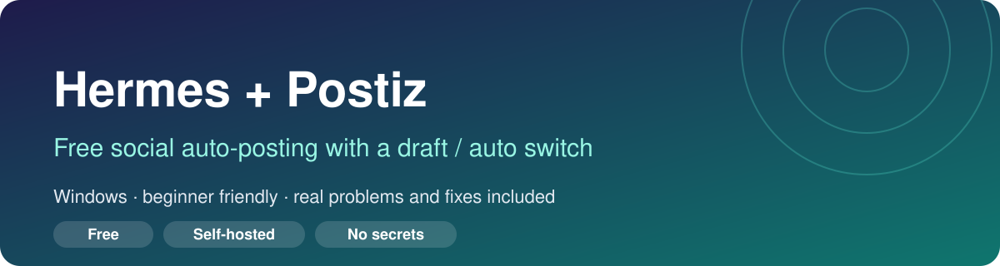
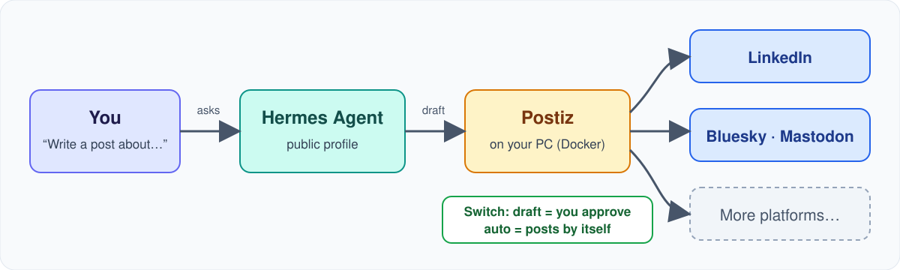
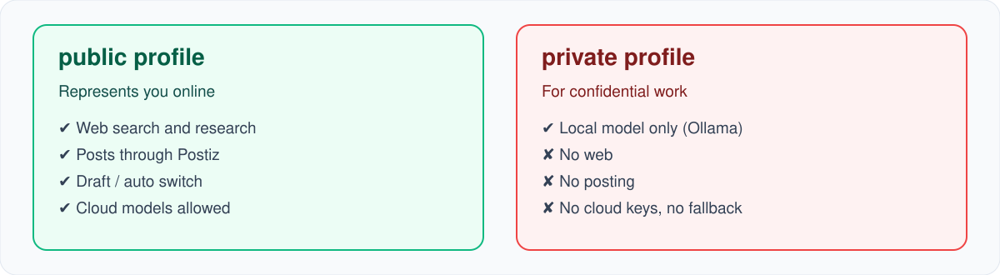

<p align="center"></p>

<p align="center">


</p>

# Make your Hermes Agent post for you. Free.

A complete, tested, **step-by-step guide** to give the [Hermes Agent](https://hermes-agent.nousresearch.com/) (Nous Research) three upgrades:

1. **Better skills** for research, searching your own notes (RAG), automation and safe web scraping.
2. **Two profiles.** A *public* one that represents you online, and a *private* one that never touches the internet.
3. **Free auto-posting** to LinkedIn and other platforms through [Postiz](https://postiz.com) running on your own PC, with a **draft / auto switch** so nothing goes live unless you allow it.

No coding needed. Every step says what to click or type. Every problem I hit while building it is written up with the fix, so you can skip them.

---

## How it works

<p align="center"></p>

You talk to Hermes. Hermes writes the post and hands it to Postiz. In **draft** mode the post waits for your OK. In **auto** mode Postiz publishes it by itself. Postiz uses the platforms' **official connections**, never a bot logging in to your account, so your accounts stay safe.

## Two profiles: public and private

<p align="center"></p>

Use **public** for brand, content and research. Switch to **private** for anything confidential, like unreleased software or client work. Nothing from private is sent to a cloud model.

---

## What you need

| Need | Notes |
|---|---|
| Windows 10/11 PC | The commands are PowerShell |
| Hermes Agent (desktop) | Already installed and working |
| [Docker Desktop](https://www.docker.com/products/docker-desktop/) | Must be running |
| [Git](https://git-scm.com/downloads) | For downloading Postiz |
| [Ollama](https://ollama.com) | Only for the private profile |
| A LinkedIn account | A LinkedIn Page is needed for the developer app |
| About 2 to 3 hours | Plus waiting for LinkedIn's approval (days) |

## Cost

| Part | Cost |
|---|---|
| Hermes skills and profiles | Free |
| Postiz (self-hosted) | Free. The paid "Plus" plan is the hosted version, you don't need it |
| LinkedIn, Bluesky, Mastodon | Free connections |
| X (Twitter) | The platform charges per post |

---

## The path

| # | Step | Time | Guide |
|---|---|---|---|
| 1 | Install the skills and the two profiles | 10 min | [Doc 1](docs/01-hermes-upgrade.md) |
| 2 | Make the private profile local-only | 15 min | [Doc 2](docs/02-private-profile.md) |
| 3 | Start Postiz with Docker | 15 min | [Doc 3](docs/03-postiz.md) |
| 4 | Create the LinkedIn developer app | 30 min + approval wait | [Doc 4](docs/04-linkedin-app.md) |
| 5 | Put the LinkedIn keys into Postiz | 10 min | [Doc 5](docs/05-linkedin-keys.md) |
| 6 | Connect Hermes to Postiz, use the switch | 20 min | [Doc 6](docs/06-hermes-postiz.md) |
| 7 | Read the safety rules | 5 min | [Doc 7](docs/07-safety.md) |
| 8 | Something broke? | | [Doc 8](docs/08-troubleshooting.md) |

### Your progress checklist
- [ ] Skills and profiles installed
- [ ] Private profile uses a local model
- [ ] Postiz opens at `http://localhost:4007`
- [ ] LinkedIn Page and developer app created and verified
- [ ] Keys placed in Postiz, LinkedIn channel connected
- [ ] First test post published by hand in Postiz
- [ ] Hermes connected (`hermes -p public mcp test postiz` says Connected)
- [ ] Hermes created a **draft** in Postiz
- [ ] Switch set to the mode you want

---

## Quick start

> Already comfortable with PowerShell? This is the short version. If any step fails, go to the [problems](problems/README.md).

```powershell
# 1. Download this repo, open PowerShell inside the "package" folder, then:
powershell -ExecutionPolicy Bypass -File .\install.ps1

# 2. Start Postiz (Docker Desktop must be running)
powershell -ExecutionPolicy Bypass -File .\postiz\setup-postiz.ps1

# 3. After the LinkedIn app and keys (docs 4 and 5), give Hermes the Postiz key
hermes -p public config set POSTIZ_API_KEY <your key>

# 4. Test the connection, then open a chat
hermes -p public mcp test postiz
public chat
```

In the chat:

| You type | What happens |
|---|---|
| `posting status` | Shows `draft` or `auto` |
| `posting on` | Posts by itself |
| `posting off` | Drafts only |
| `Create a DRAFT LinkedIn post: "…". Do not publish.` | Creates a draft in Postiz |

---

## Where things go wrong

These twelve problems cost the most time. Each has a one-page fix.

| Problem | Fix |
|---|---|
| A config line is "already defined" or a "duplicate key" | [#5](problems/05-duplicate-linkedin-key.md), [#8](problems/08-duplicate-mcp-servers.md): **search the file first, edit the existing line** |
| `401 Invalid API Key` | [#10](problems/10-mcp-401.md) |
| `NotEnoughScopes` on LinkedIn | [#7](problems/07-notenoughscopes.md) |
| A secret got pasted in a chat | [#6](problems/06-leaked-secret.md) |
| `client_id` error | [#4](problems/04-client-id-error.md) |

All twelve: [problems/](problems/README.md). The order things happened in: [JOURNEY.md](JOURNEY.md).

---

## Safety in four lines
- Real keys live in `.env` files or the `hermes config set` command. **Never in chats, screenshots or GitHub.**
- Postiz uses the official connections. **No bots logging in to your accounts.**
- Start in **draft** mode. Turn on `auto` only when you trust the output.
- The private profile has no web access and no cloud keys.

More: [Doc 7](docs/07-safety.md).

## Status of this guide

| Part | State |
|---|---|
| Skills and profiles install | Tested |
| Postiz in Docker | Tested |
| LinkedIn app, keys, personal profile post | Tested |
| Hermes ↔ Postiz connection, draft creation | Tested |
| `auto` mode posting, scheduled posts | Not yet tested |
| LinkedIn **Page** channel | Not yet tested |
| Advertising API approval | Pending from LinkedIn; may be refused |

## What's in this repo

```
README.md          you are here
JOURNEY.md         what was done, in order
docs/              the guide, steps 1 to 8, plus docs/images
problems/          12 real problems, one short page each
package/           the files the installer uses (skills, profiles, scripts)
```

## Contributing
Found a step that's unclear or a new problem? Open an issue or a pull request. Never include keys, tokens or personal data.

## License
[MIT](LICENSE)
